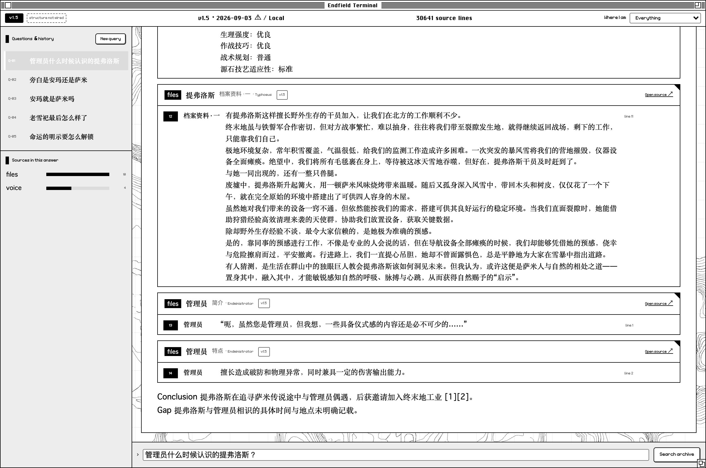
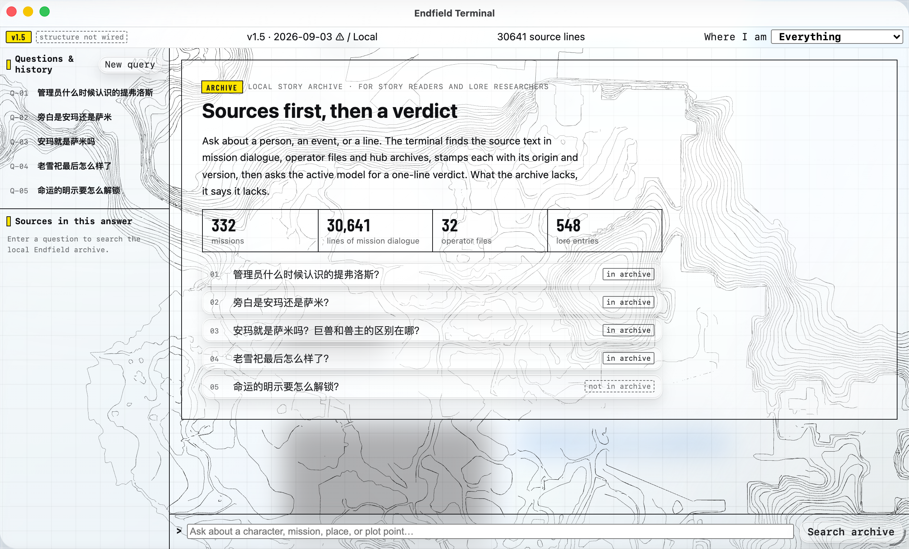

# Endfield Terminal

A browser story-archive terminal for *Arknights: Endfield*: ask a plot
question, see numbered source lines, then a one-line verdict. A host page can
embed the same files in a frame.

The app is TypeScript + Preact. The article builders, the archive's guards and
the terminal's own flow are unit-tested; the browser specs drive the real page
against a stand-in desk, including a Chinese composition in the command bar.

## Screenshots

Captured running inside the AI System 6 desk: Classic on the left, Liquid Glass on the right.

<p> </p>

## Run on its own

```bash
npm ci
npm run dev
```

Then open `http://localhost:5173/terminal/index.html`.

On its own page there is no desk. Every `endfield.*` service answers
`unavailable`, and the terminal shows its existing error card. Nothing else
changes.

## Real deployment

A host desk must offer these bridge services (capability `services`) and accept
`context.publish` (capability `context`):

| Service | Role |
| --- | --- |
| `endfield.search` | Empty params → archive meta for the header; with a body → corpus search |
| `endfield.ask` | `{ query, progress }` → the rendered answer object (`query`, `answer`, `results` cut to 14, `meta`, `ai_system6_metrics`, …) or `{ ok: false, reason }` |
| `endfield.answer` | Optional later use; this page does not call it |

The lore system prompt stays on the host. The framed page never reads a
provider, model route, credential, key, base URL or endpoint.

The host also needs:

- `intent.dispatch` with `clip` to File Floppy and `ask` to SideAsk
- desk-made `welcome.launch` / `launch.changed` with `{ evidence: n }` so a
  citation can open, scroll to and focus `#endfield-evidence-n`
- readers of `publishedContext("endfieldTerminal")` for SideAsk / ClioTalk
  grounding (`kind: "endfield"`, value `{ query, answer, results }`)

## Check

```bash
npm run check       # types (strict), Biome, unit tests, build
npm run test:e2e    # the built page in Chromium, with and without a desk
```

## Build

```bash
npm run build
```

Writes what a host page embeds into `dist/`: the page the manifest names
(`terminal/index.html`), the kit's files beside it, one stylesheet, one module
bundle, and the background and font the stylesheet names.

## Layout

| Path | What it is |
| --- | --- |
| `terminal/index.html` | The page the manifest names; the build rewrites its module and stylesheet links |
| `src/app/` | The terminal's state and flow: the question, the answer, the clips and the menus |
| `src/bridge/` | The typed bridge client: services and their cancellation, context, intents, state |
| `src/data/` | The archive's types and guards, the progress order and the question lists |
| `src/view/` | The article builders: welcome, searching, an answer's evidence, verdicts, the clip file |
| `src/ui/` | The Preact window: status line, sidebar, terminal and command bar |
| `src/styles/` | Base styles and the terminal's stylesheet, carried over from 1.0.1 |
| `src/assets/` | Background SVG and the Barlow Condensed Latin subset |
| `public/` | `ais6-bridge.js`, `kit.css` and `app.manifest.json`, copied to the build's root |
| `tools/probe.mjs`, `tools/host-stub.mjs`, `tools/compare.mjs` | The comparison probe, its stand-in desk, and the diff |
| `tests/unit/`, `tests/e2e/` | Vitest, Playwright |

## Licence

Code is MIT. See [LICENSE](LICENSE). The theme and background are used with
permission and are **not** under MIT — see [LICENSES.md](LICENSES.md).

中文：[README.zh-CN.md](README.zh-CN.md).

## Changelog

### 1.1.0 — 2026-11-22

- TypeScript + Preact, strict `tsc` and Biome. Same window, copy, menu verbs,
  bridge messages, state key (`recent`, including the pre-move default question
  list it still migrates) and `dist` behaviour. The `data-i18n*` attributes the
  old runtime swept with `translateWithin` are gone: strings come from typed
  tables, and the texts, labels and placeholders they produced are unchanged.
- What a language switch touches is unchanged: the window's chrome re-labels,
  and an answer already on screen keeps the language it was drawn in.
