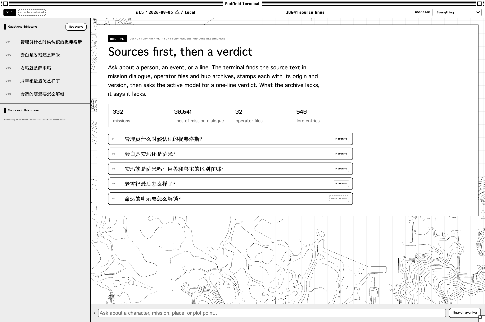
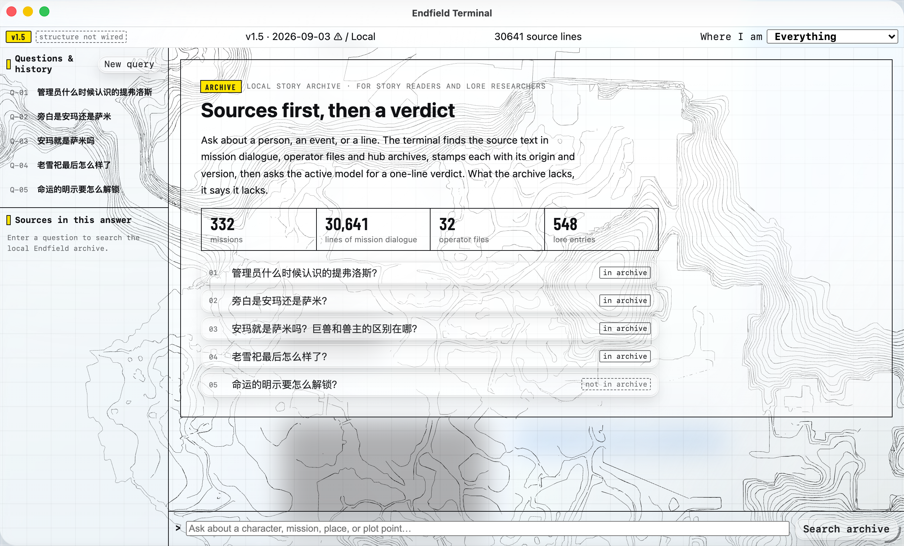

# 终末地剧情终端（Endfield Terminal）

一个在浏览器里运行的《明日方舟：终末地》剧情资料库终端：提问、看带编号的
原文、再读一句结论。也可由宿主页面嵌进窗口。

## 截图

在 AI System 6 桌面里实际运行时截取，左为 Classic，右为 Liquid Glass。

<p> </p>

## 单独打开

```bash
npm start
```

然后打开 `http://localhost:8080/terminal/`。

单独打开时没有宿主桌面。每一个 `endfield.*` 服务都会应答 `unavailable`，
终端显示既有的错误卡片。除此以外界面不变。

## 真实部署

宿主桌面需要提供这些 bridge 服务（能力 `services`），并接受
`context.publish`（能力 `context`）：

| 服务 | 作用 |
| --- | --- |
| `endfield.search` | 空参数 → 页眉用的资料库 meta；有 body → 语料检索 |
| `endfield.ask` | `{ query, progress }` → 可渲染的回答对象（`query`、`answer`、截到 14 条的 `results`、`meta`、`ai_system6_metrics` 等），或 `{ ok: false, reason }` |
| `endfield.answer` | 留给以后用；本页不调用 |

剧情系统提示词留在宿主一侧。嵌进框架的页面从不读取供应商、模型路由、
凭证、密钥、base URL 或 endpoint。

宿主还需要：

- 用 `intent.dispatch` 把 `clip` 送到文件软盘、把 `ask` 送到 SideAsk
- 桌面发起的 `welcome.launch` / `launch.changed`，带 `{ evidence: n }`，以便
  引用打开并滚到、聚焦 `#endfield-evidence-n`
- 用 `publishedContext("endfieldTerminal")` 读 SideAsk / ClioTalk 的 grounding
  （`kind: "endfield"`，值为 `{ query, answer, results }`）

## 构建

```bash
npm run build
```

把宿主页面要嵌入的文件复制到 `dist/`（与本树逐文件相同）。没有依赖，有
Node 就行。

## 目录

| 路径 | 内容 |
| --- | --- |
| `terminal/` | 页面、终端模块、样式表、中英文字符串表 |
| `shared/` | 基础样式，以及对接 bridge 的运行时 |
| `assets/` | 背景 SVG，以及 Barlow Condensed 拉丁子集 |
| `ais6-bridge.js`、`kit.css`、`app.manifest.json` | 让宿主页面把终端嵌进框架、代管最近提问并画出菜单；单独打开时，同样的调用退回本地存储 / 不可用的服务 |
| `tools/build.mjs` | 把嵌入用的文件复制到 `dist/` |

## 许可

代码为 MIT。见 [LICENSE](LICENSE)。主题与背景经授权使用，**不在** MIT
之下——见 [LICENSES.md](LICENSES.md)。

English: [README.md](README.md).
